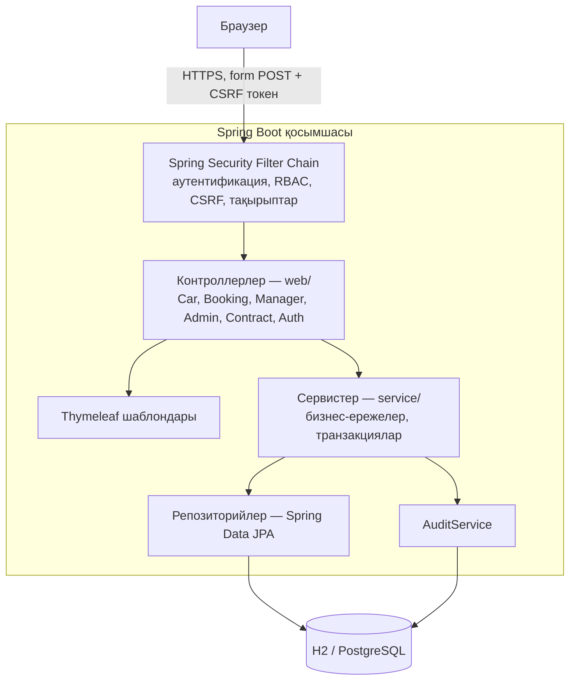
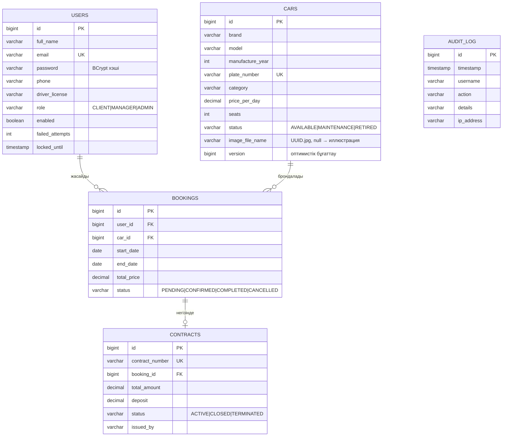
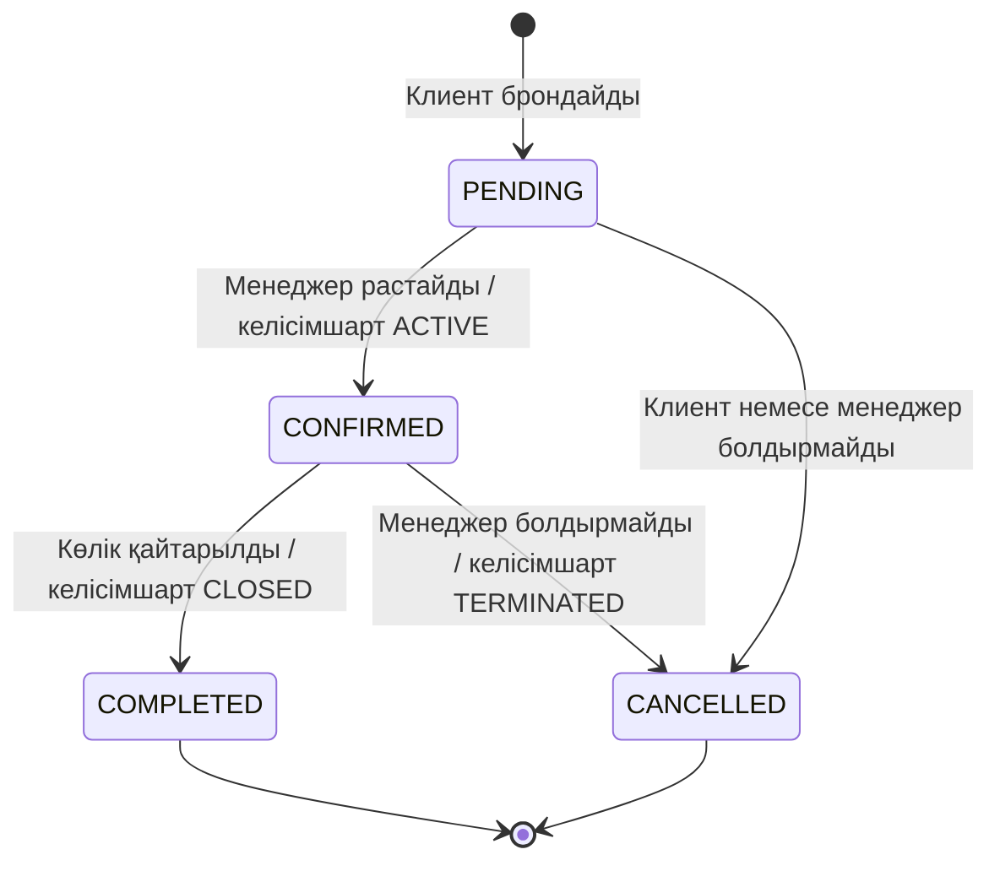
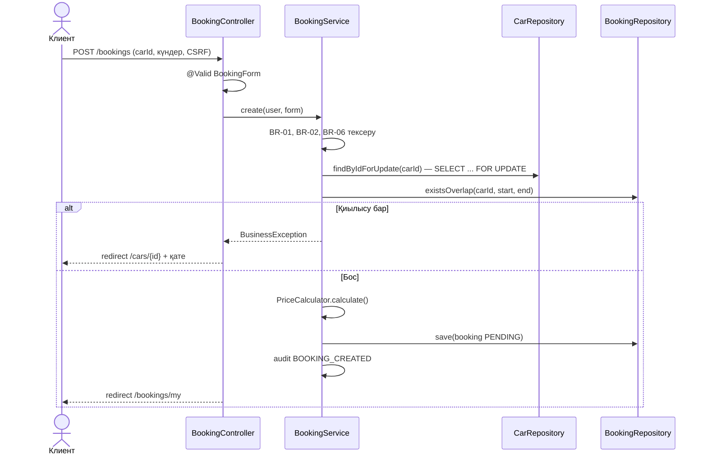

# 2. Жобалау: архитектура, деректер моделі, интерфейс

## 2.1. Архитектура

Жүйе классикалық **көпқабатты (layered) архитектурамен** құрылған — Spring MVC + сервер жағында рендеринг (Thymeleaf).

| Қабат | Жауапкершілігі | Мысал |
|-------|----------------|-------|
| Security | Кім кіре алады, қандай URL-ге | `SecurityConfig`, `LoginFailureHandler` |
| Web (Controller) | HTTP сұранысын қабылдау, валидация, модельді шаблонға беру | `BookingController` |
| Service | Бизнес-ережелер, транзакция шекарасы | `BookingService.create()` |
| Repository | Дерекқорға қол жеткізу | `BookingRepository.existsOverlap()` |
| Model | Домен объектілері (JPA entity) | `Booking`, `Contract` |
| DTO | Форма деректері, валидация | `BookingForm` |

**Неге Thymeleaf, REST + React емес?** Бір deploy-артефакт, CSRF және сессия Spring Security-де дайын, топқа фронтенд-стекті қосымша үйренудің қажеті жоқ. Сервистер қабаты контроллерден тәуелсіз, сондықтан REST API-ді кейін қосу оңай.

## 2.2. Деректер моделі (ER-диаграмма)

`bookings(car_id, start_date, end_date)` бойынша индекс — қиылысуды тексеру сұранысын жылдамдатады.

## 2.3. Брон мен келісімшарттың өмірлік циклі

## 2.4. Брондау алгоритмі (негізгі сценарий)

## 2.5. URL картасы және қол жеткізу матрицасы

| URL | Әдіс | Қонақ | Клиент | Менеджер | Әкімші |
|-----|------|:-----:|:------:|:--------:|:------:|
| `/`, `/cars`, `/cars/{id}` | GET | ✅ | ✅ | ✅ | ✅ |
| `/img/**` (иллюстрациялар), `/images/cars/{uuid}` (жүктелген фотолар) | GET | ✅ | ✅ | ✅ | ✅ |
| `/login`, `/register` | GET/POST | ✅ | — | — | — |
| `/bookings` | POST | ❌ | ✅ | ✅ | ✅ |
| `/bookings/my` | GET | ❌ | ✅ | ✅ | ✅ |
| `/bookings/{id}/cancel` | POST | ❌ | ✅ (тек өзінікі) | ✅ (өзінікі) | ✅ (өзінікі) |
| `/contracts/{id}` | GET | ❌ | ✅ (тек өзінікі) | ✅ | ✅ |
| `/manager/bookings`, `/manager/contracts` | GET | ❌ | ❌ | ✅ | ✅ |
| `/manager/bookings/{id}/confirm\|complete\|cancel` | POST | ❌ | ❌ | ✅ | ✅ |
| `/admin/cars/**` | GET/POST | ❌ | ❌ | ❌ | ✅ |
| `/admin/users/**` | GET/POST | ❌ | ❌ | ❌ | ✅ |
| `/admin/audit` | GET | ❌ | ❌ | ❌ | ✅ |

Тексеру екі деңгейде: URL ережелері (`SecurityConfig`) **және** контроллер класындағы `@PreAuthorize` (defense in depth). Объект деңгейіндегі тексеру («тек өзінікі») — сервисте/контроллерде.

## 2.6. Интерфейс беттері

| Бет | Шаблон |
|-----|--------|
| Басты бет: іздеу формасы, танымал көліктер | `index.html` |
| Автопарк каталогы + сүзгілер | `cars/list.html` |
| Көлік карточкасы + брондау формасы + бос емес күндер | `cars/detail.html` |
| Менің брондарым | `bookings/my.html` |
| Брондарды басқару (менеджер) | `manager/bookings.html` |
| Келісімшарттар тізімі | `manager/contracts.html` |
| Келісімшарт (басып шығаруға дайын) | `contracts/view.html` |
| Автопаркті басқару, көлік формасы | `admin/cars.html`, `admin/car-form.html` |
| Пайдаланушылар, аудит журналы | `admin/users.html`, `admin/audit.html` |
| Кіру, тіркелу, 403, қате | `auth/*.html`, `access-denied.html`, `error.html` |
