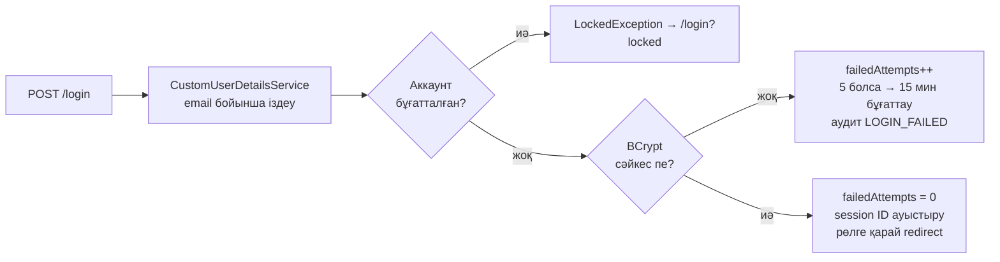

# 3. Қауіпсіздік моделі

## 3.1. Қорғалатын активтер

| Актив | Неге маңызды |
|-------|--------------|
| Пайдаланушылардың дербес деректері (аты-жөні, телефон, жүргізуші куәлігі) | ҚР «Дербес деректер және оларды қорғау туралы» Заңы |
| Есептік жазбалар мен құпиясөздер | Аккаунтты басып алу → бөтен атынан брон/келісімшарт |
| Брондар мен келісімшарттар | Қаржылық және заңды маңызы бар құжаттар |
| Автопарк туралы деректер (баға, күй) | Бағаны өзгерту → қаржылық шығын |
| Аудит журналы | Инциденттерді тергеу үшін дәлел |

## 3.2. Қатерлер моделі (STRIDE)

| # | Санат | Қатер | Ықтималдық / Әсер | Қорғаныс шарасы | Код |
|---|-------|-------|-------------------|-----------------|-----|
| T1 | **S**poofing | Құпиясөзді іріктеу (brute-force) | Жоғары / Жоғары | 5 сәтсіз әрекет → 15 мин бұғаттау; BCrypt(12) баяу хэш | `LoginAttemptService` |
| T2 | **S**poofing | Сессияны ұрлау / фиксациялау | Орта / Жоғары | Кіргенде session ID ауыстырылады; HttpOnly, SameSite cookie; 30 мин timeout | `SecurityConfig`, `application.yml` |
| T3 | **S**poofing | Email бойынша аккаунттың бар-жоғын анықтау (user enumeration) | Орта / Төмен | «Email немесе құпиясөз қате» — бірдей хабарлама | `LoginFailureHandler` |
| T4 | **T**ampering | CSRF — қолданушы атынан брон жасау/болдырмау | Орта / Жоғары | CSRF токен барлық POST-та (Thymeleaf автоматты қосады) | Spring Security әдепкі |
| T5 | **T**ampering | Mass assignment — тіркелгенде `role=ADMIN` жіберу | Орта / Өте жоғары | Формалар үшін бөлек DTO; рөл серверде `CLIENT` болып қойылады | `RegisterForm`, `UserService` |
| T6 | **T**ampering | Бағаны/сомасын клиент жағында өзгерту | Жоғары / Жоғары | Құн тек серверде есептеледі; формада баға жоқ | `PriceCalculator` |
| T7 | **T**ampering | SQL-инъекция | Төмен / Өте жоғары | Тек JPA/JPQL параметрлері, string concatenation жоқ | `BookingRepository` |
| T8 | **T**ampering | Қос брондау (race condition) | Орта / Орта | `SELECT ... FOR UPDATE` пессимистік бұғаттау | `CarRepository.findByIdForUpdate` |
| T9 | **R**epudiation | «Мен бұл бронды жасамадым / растамадым» | Орта / Орта | Аудит журналы: кім, не, қашан, IP; келісімшартта `issuedBy` | `AuditService` |
| T10 | **I**nformation disclosure | IDOR — `/contracts/5` → `/contracts/6` бөтен келісімшарт | Жоғары / Жоғары | Иесін тексеру; бұзу әрекеті аудитке жазылады | `ContractController`, `BookingService.cancelByClient` |
| T11 | **I**nformation disclosure | XSS — көлік сипаттамасына `<script>` енгізу | Орта / Жоғары | `th:text` экрандайды; CSP `script-src 'self'` | шаблондар, `SecurityConfig` |
| T12 | **I**nformation disclosure | Қате беттерінде stack trace | Орта / Орта | `include-stacktrace: never`, жалпы қате беті | `application.yml`, `error.html` |
| T13 | **I**nformation disclosure | Дерекқор ағып кетсе, құпиясөздер ашылады | Төмен / Өте жоғары | BCrypt + әр хэште salt; ашық мәтін сақталмайды | `PasswordConfig` |
| T14 | **D**enial of service | Бір клиент барлық көлікті брондап тастайды | Орта / Орта | Ең көбі 3 расталмаған брон, 30 тәулік, 180 күн алдын ала | `BookingService` |
| T15 | **D**enial of service | Clickjacking | Төмен / Орта | `X-Frame-Options: DENY`, CSP `frame-ancestors 'none'` | `SecurityConfig` |
| T16 | **E**levation of privilege | Клиент `/admin/**` ашады | Жоғары / Өте жоғары | URL ережелері + `@PreAuthorize` (екі деңгей) | `SecurityConfig`, `AdminController` |
| T17 | **E**levation of privilege | Әкімші өз рөлін түсіріп, жүйе әкімшісіз қалады | Төмен / Орта | Өз рөлін/аккаунтын өзгертуге тыйым | `UserService.changeRole` |
| T18 | **T**ampering / **E**levation | Фото ретінде зиянды файл жүктеу (HTML/SVG ішінде скрипт → stored XSS; `.jsp` → кодты орындау) | Орта / Өте жоғары | Түрі magic bytes бойынша тексеріледі (тек JPEG/PNG/WebP), SVG қабылданбайды; атауы серверде UUID; файлдар `static/`-тан тыс сақталады және тек `image/*` түрімен беріледі; `nosniff` | `ImageStorageService` |
| T19 | **I**nformation disclosure | Path traversal: `/images/cars/../../application.yml` | Орта / Жоғары | Атау қатаң регулярлы өрнекпен тексеріледі + `normalize()` және папкадан шықпауы тексеріледі | `ImageStorageService.find` |
| T20 | **D**enial of service | Үлкен файлдармен дискіні толтыру | Төмен / Орта | 5 МБ шегі (сервис), 10 МБ multipart шегі; жүктеу тек әкімшіге рұқсат | `application.yml`, `SecurityConfig` |

## 3.3. OWASP Top 10 (2021) сәйкестігі

| OWASP | Жобадағы шешім |
|-------|----------------|
| A01 Broken Access Control | RBAC (3 рөл), `@PreAuthorize`, IDOR тексеру, 403 беті |
| A02 Cryptographic Failures | BCrypt(12); өндірісте `cookie.secure=true` (postgres профилі), HTTPS ұсынылады |
| A03 Injection | JPA параметрлері; Thymeleaf экрандауы; Bean Validation; жүктелетін файлдар мазмұны бойынша тексеріледі |
| A04 Insecure Design | Бизнес-ережелер серверде; күй машинасы (тек рұқсат етілген ауысулар) |
| A05 Security Misconfiguration | Stack trace жасырылған; қауіпсіздік тақырыптары; құпиясөздер env арқылы |
| A07 Identification & Authentication Failures | Құпиясөз саясаты (8+ таңба, әріп+цифр), бұғаттау, session fixation қорғанысы |
| A08 Software & Data Integrity | Оптимистік (`@Version`) және пессимистік бұғаттау |
| A09 Logging & Monitoring Failures | Аудит журналы (`REQUIRES_NEW` — транзакция кері қайтарылса да сақталады) |

## 3.4. Аутентификация және авторизация

**Құпиясөз саясаты:** 8–64 таңба, кемінде бір әріп және бір цифр.

**Рөлдер:** `CLIENT` (тіркелгенде әдепкі), `MANAGER`, `ADMIN`. Рөлді тек әкімші өзгерте алады, әрбір өзгеріс аудитке жазылады.

## 3.5. HTTP қауіпсіздік тақырыптары

| Тақырып | Мәні | Неден қорғайды |
|---------|------|----------------|
| `Content-Security-Policy` | `default-src 'self'; script-src 'self'; style-src 'self'; img-src 'self' data: blob:; frame-ancestors 'none'; ...` | XSS, clickjacking, бөтен скрипттер. `blob:` — жүктелетін фотоны алдын ала көрсету үшін ғана |
| `X-Frame-Options` | `DENY` | Clickjacking |
| `X-Content-Type-Options` | `nosniff` | MIME-sniffing |
| `Referrer-Policy` | `strict-origin-when-cross-origin` | URL арқылы ақпарат ағуы |
| `Cache-Control` | `no-cache, no-store` (Spring Security) | Ортақ компьютерде кэштен деректерді оқу |

CSP inline скрипттерге тыйым салатындықтан, барлық JS `static/js/app.js` файлында (`onclick` атрибуттары жоқ).

## 3.6. Аудит журналы

Тіркелетін оқиғалар: `REGISTER`, `LOGIN_SUCCESS`, `LOGIN_FAILED`, `LOGIN_BLOCKED`, `LOGIN_DISABLED`, `ACCOUNT_LOCKED`, `ACCESS_DENIED`, `BOOKING_CREATED/CONFIRMED/CANCELLED/COMPLETED`, `CONTRACT_CREATED/CLOSED/TERMINATED`, `CAR_CREATED/UPDATED/DELETED/RETIRED`, `ROLE_CHANGED`, `USER_ENABLED/DISABLED/UNLOCKED`.

Әр жазбада: уақыт, пайдаланушы, әрекет, толығырақ, IP-адрес. Әкімші панелінде күдікті оқиғалар (`ACCESS_DENIED`, `LOGIN_FAILED`, `ACCOUNT_LOCKED`) түспен ерекшеленеді.

## 3.7. Белгілі шектеулер және келесі қадамдар

- Демо-құпиясөздер кіру бетінде көрсетілген — өндірісте `login.html`-дегі «Демо-аккаунттар» блогын алып тастау керек.
- HTTPS-ті reverse proxy (nginx) немесе `server.ssl.*` арқылы қосу керек.
- Email растау және құпиясөзді қалпына келтіру жоқ.
- Бұғаттау тек бар аккаунттарға қолданылады; IP бойынша rate limiting (мысалы, Bucket4j) қосуға болады.
- Екі факторлы аутентификация (TOTP) — менеджер мен әкімші үшін ұсынылады.
- Жүргізуші куәлігінің нөмірін дерекқорда шифрлау (JPA `AttributeConverter` + AES).
